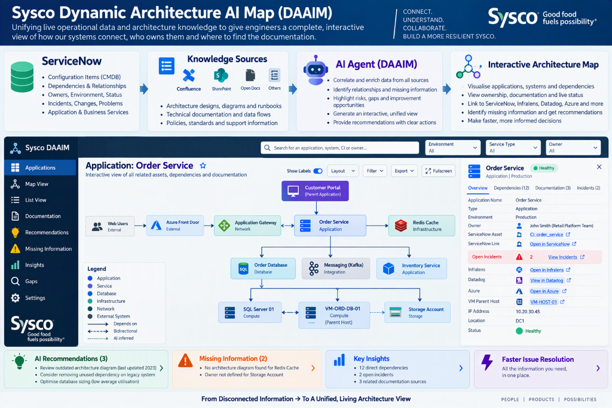
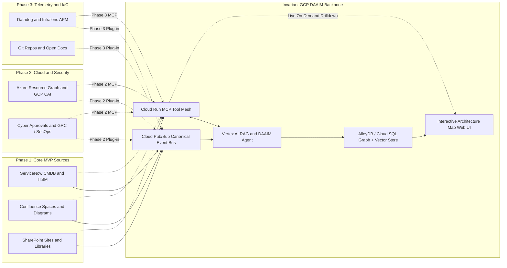
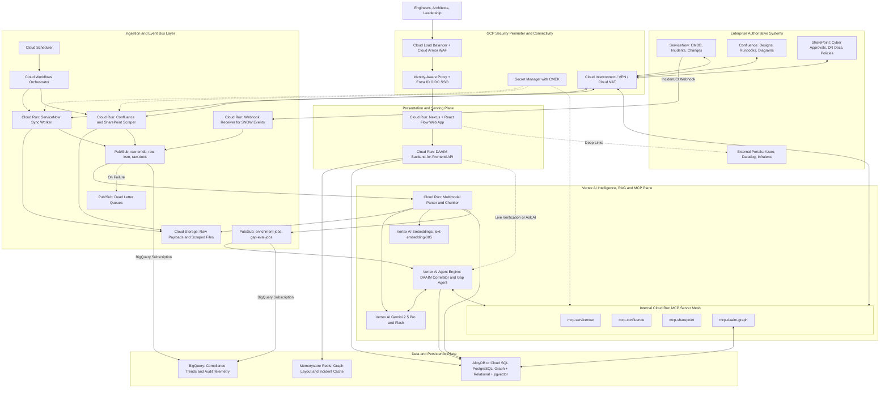
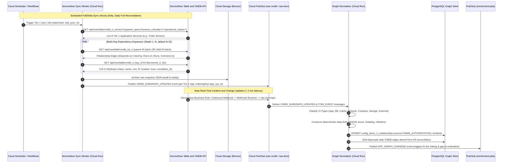
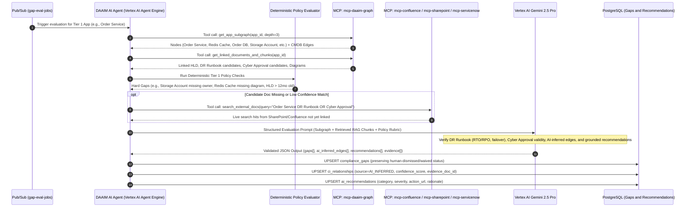
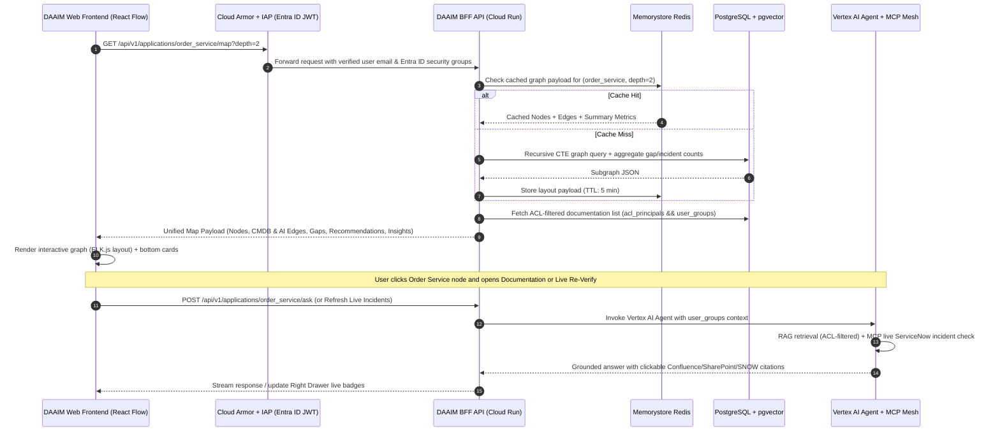
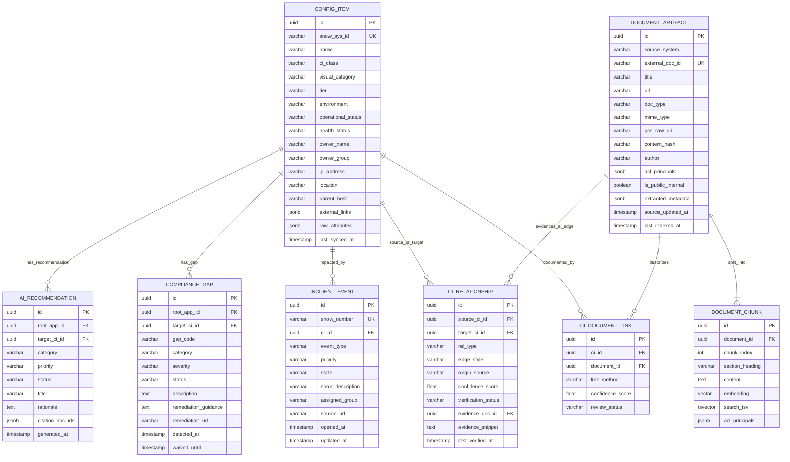
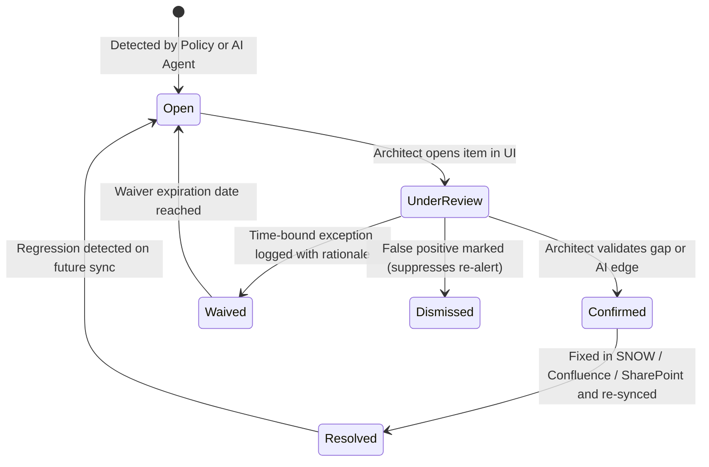
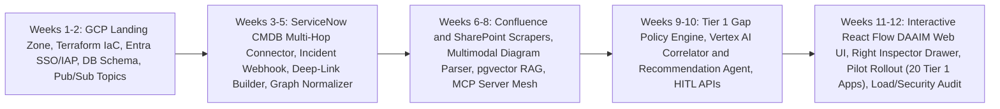

# System Design Document: Dynamic Architecture AI Map (DAAIM)

**Status:** Draft v1.0 (Architecture Proposal)  
**Target Platform:** Google Cloud Platform (GCP)  
**Scope:** Phase 1 MVP (ServiceNow CMDB/ITSM + Confluence & SharePoint + Deep Links) with Phased Extension Architecture for Cloud Discovery, Security/GRC, and Observability  

---

## 1. Executive Summary & Goals

Enterprise infrastructure, application dependency, ownership, and governance knowledge is currently fragmented across ServiceNow CMDB, Confluence, SharePoint, cloud consoles (Azure/GCP/on-prem), and security/observability tooling. While each platform remains the **authoritative system of record**, engineers and architects must manually stitch together context during incident response, change impact analysis, Disaster Recovery (DR) audits, and architecture reviews.

**Dynamic Architecture AI Map (DAAIM)** solves this by creating a **unified, read-only, AI-enriched architectural intelligence plane on GCP**. It continuously ingests critical **Tier 1 applications** and their multi-hop dependency graphs from ServiceNow CMDB, correlates them with scraped technical documentation (High-Level Designs, DR runbooks, cyber security approvals, support docs) from Confluence and SharePoint using **Vertex AI (RAG + Multimodal + MCP)**, surfaces **missing documentation and governance gaps**, and renders an interactive living architecture map.



### 1.1 Architectural Principles

1. **Authoritative Systems Stay Authoritative (Read-Only Integration):** DAAIM never mutates ServiceNow CMDB, Confluence, or SharePoint in Phase 1. Corrections, gap resolutions, and ownership fixes link engineers directly back to the source record (with optional human-in-the-loop verification inside DAAIM).
2. **Deterministic Graph First, AI Enrichment Second:** CMDB relationships (`Depends on`, `Bidirectional`) are treated as baseline truth. Relationships discovered in diagrams or documentation are explicitly tagged and visually distinguished as **`AI inferred`** (dotted green edge) with confidence scores and source citations.
3. **Event-Driven & Connector-Extensible:** Every data source integrates via decoupled Cloud Run connectors publishing canonical envelopes to **Cloud Pub/Sub** and exposing standardized read tools via **Model Context Protocol (MCP)** servers. Adding Phase 2/3 sources requires zero changes to core graph or UI engines.
4. **Zero-Trust & Source-ACL Fidelity:** RAG retrieval and document previews respect enterprise RBAC and source document access permissions so sensitive security approvals or restricted SharePoint sites are never leaked to unauthorized users.
5. **Grounded AI Only:** Every gap finding, recommendation, and extracted attribute must include verifiable deep links, chunk citations, and extraction timestamps to prevent hallucinated compliance sign-offs.

---

## 2. Phased Delivery Strategy

To deliver business value rapidly while accommodating the broader enterprise estate, DAAIM follows a three-phase rollout built on a single invariant GCP backbone.

| Phase | Scope & Ingested Sources | Key Capabilities Delivered |
| :--- | :--- | :--- |
| **Phase 1 (MVP)** | **ServiceNow** (Tier 1 Business/Application Services, CMDB CIs & relationships, Incidents/Changes/Problems) + **Confluence** & **SharePoint** (HLD/LLD designs, diagrams, DR runbooks, cyber approvals, policies) | Interactive Tier 1 dependency map; right-hand CI inspector with deterministic deep links to ServiceNow, Infralens, Datadog, and Azure; RAG document correlation; automated **Gap Detection** (missing designs, DR runbooks, cyber approvals, owners, stale docs); AI Recommendations & AI-inferred edge proposals. |
| **Phase 2 (Cloud & GRC)** | **Cloud Discovery APIs** (Azure Resource Graph, GCP Cloud Asset Inventory, AWS Config, on-prem vCenter/CMDB discovery) + **Security & GRC Tooling** (ServiceNow GRC/SecOps, Wiz/Qualys vulnerability feeds, Cyber Approval registries) | Automated **CMDB vs. Cloud Drift Detection** (shadow infrastructure not in SNOW); automated Cyber Approval expiry/ATO verification; live vulnerability/risk overlays directly on architecture graph nodes. |
| **Phase 3 (Observability & Agentic Ops)** | **Observability & APM** (Datadog, Infralens metrics/service maps, OpenTelemetry traces) + **Git/OpenDocs** (Architecture-as-Code repos, Terraform/IaC) | Live node health from APM; automated right-sizing & unused-dependency recommendations backed by telemetry; blast-radius simulation for Change Requests; conversational Vertex AI Architect Co-Pilot via MCP. |



---

## 3. High-Level GCP System Architecture

### 3.1 Logical Architecture Diagram



### 3.2 GCP Component Selection & Architectural Trade-Offs

| Architectural Layer | Recommended GCP Choice (Phase 1) | Why This Choice Fits DAAIM | Key Alternatives & When to Switch |
| :--- | :--- | :--- | :--- |
| **Compute (Web, API, Workers, MCP)** | **Cloud Run** (Services & Jobs) | Serverless autoscaling (scale-to-zero for batch connectors, fast cold start for API/MCP), native VPC connector, IAM service-to-service auth for internal MCP servers, zero cluster ops. | **GKE Autopilot** if heavy custom sidecars, long-running streaming jobs (>60 min), or enterprise K8s standardization is mandatory. |
| **Event Bus** | **Cloud Pub/Sub** (with Schemas, Ordering Keys & DLQs) | Native decoupling between slow external APIs (SNOW/SharePoint throttling) and heavy AI processing; built-in dead-lettering, replay via seek/retention, and zero-code BigQuery subscriptions. | **Cloud Tasks** only for simple point-to-point HTTP retries; Pub/Sub is superior here because multiple consumers (Graph Updater, AI Enricher, BigQuery Analytics) subscribe to the same events. |
| **Primary Graph + Relational + Vector DB** | **AlloyDB for PostgreSQL** (or **Cloud SQL Enterprise Plus PostgreSQL** for lower MVP cost) with `pgvector` (ScaNN) | **Single transactional engine** for CMDB entities, multi-hop recursive CTE graph queries (50k–200k CIs traverse in <50ms), Gap/Recommendation tables, **AND** ACL-filtered vector similarity search (`WHERE 'group:retail-eng' = ANY(acl_principals)`). Eliminates cross-database sync drift. | **Cloud Spanner Graph** (GQL native) if enterprise scale exceeds 500k+ CIs with deep arbitrary-hop traversals (>6 hops) or global multi-region active-active is required. **Neo4j Aura on GCP** if complex graph algorithms (PageRank/community detection) become core. |
| **RAG & Vector Retrieval** | **Hybrid Search in PostgreSQL (`pgvector` + `tsvector` BM25) + Vertex AI `text-embedding-005`** (with optional **Vertex AI RAG Engine** evaluation) | Gives exact SQL-level filtering by `ci_id`, `doc_type`, `environment`, and `user_acl_groups` alongside semantic similarity and keyword matching (crucial for exact CI names like `VM-ORD-DB-01` or `10.20.30.45` where pure vector search struggles). | **Vertex AI Search (Enterprise Edition)** if out-of-the-box managed SharePoint/Confluence connectors with built-in ACL sync are preferred over custom scrapers (note: higher licensing cost and less granular control over custom diagram parsing). |
| **LLM & Multimodal Intelligence** | **Vertex AI Gemini 2.5 Flash** (high-volume parsing, classification, diagram OCR) + **Gemini 2.5 Pro** (complex gap reasoning, cross-doc correlation, recommendations) | Multimodal native support lets DAAIM directly read architecture diagrams (PNG/PDF/Visio exports/Draw.io), extract system boxes/arrows, and compare them against CMDB. Tiered model routing cuts LLM cost by ~70%. | Standardize on **Vertex AI Context Caching** for repeated Tier 1 compliance policy prompts. |
| **Agent & Tooling Framework** | **Vertex AI Agent Engine (ADK)** + **Cloud Run MCP Servers** | Cleanly standardizes external integrations behind JSON-RPC MCP tool contracts so the AI agent can query CMDB/Confluence/SharePoint live without hard-coded API spaghetti, and seamlessly onboards Phase 2/3 tools. | Custom LangGraph / Python orchestrator on Cloud Run if tighter custom state-machine control is preferred over managed Agent Engine. |
| **Raw Storage & Cache** | **Cloud Storage (GCS)** + **Memorystore for Redis** | GCS stores raw CMDB snapshots, scraped PDFs/DOCX, and extracted diagram images immutably (auditability + re-indexing without re-scraping). Redis caches computed graph JSON layouts and recent SNOW incident badges (<10ms UI loads). | Firestore could replace Redis for lightweight caching, but Redis excels at TTL-based hot incident/graph payload caching. |

> [!TIP]
> **Cost-Smart Database Path:** Start Phase 1 development and pilot on **Cloud SQL for PostgreSQL 16 (Enterprise Edition + `pgvector`)**. Because AlloyDB is 100% PostgreSQL wire-compatible, you can upgrade to **AlloyDB with ScaNN vector indexing** in Phase 2 via Database Migration Service (DMS) with zero application code changes when corpus volume or concurrent users scale up.

---

## 4. End-to-End System Flows

### 4.1 Flow A: Tier 1 Application & Dependency Graph Ingestion (ServiceNow CMDB + ITSM)

ServiceNow CMDB serves as the structural seed for DAAIM. Rather than ingesting the entire CMDB indiscriminately, DAAIM starts from **Tier 1 Critical Business/Application Services** and performs a bounded multi-hop BFS traversal across `cmdb_rel_ci` to capture upstream consumers, downstream databases, caches, middleware, network gateways, compute hosts, and storage accounts.



**Key Engineering Details for ServiceNow Ingestion:**
- **Pagination & Rate Limiting:** Use `sysparm_limit=500` with `sysparm_offset` or `sys_id` cursor pagination (`ORDERBYsys_id`) to avoid ServiceNow memory timeouts. Implement exponential backoff on HTTP 429/503 and cap concurrent worker connections to protect production SNOW instances.
- **Canonical CI Type Mapping:** ServiceNow CMDB classes (`cmdb_ci_appl`, `cmdb_ci_db_mssql_instance`, `cmdb_ci_linux_server`, `cmdb_ci_vm_instance`, `cmdb_ci_lb`, `cmdb_ci_cloud_storage_account`) are normalized into DAAIM's visual legend taxonomy (`Application`, `Service`, `Database`, `Infrastructure`, `Network`, `Integration`, `External System`) via a declarative YAML mapping table.
- **Relationship Direction Normalization:** ServiceNow relationship types like `Depends on::Used by` and `Runs on::Runs` are mapped into directional graph edges (`DEPENDS_ON`, `BIDIRECTIONAL`, `HOSTED_ON`).

---

### 4.2 Flow B: Documentation Scraping, Multimodal Parsing & RAG Indexing (Confluence & SharePoint)

Documentation is discovered via two complementary mechanisms:
1. **Configured Enterprise Spaces/Sites:** Designated Architecture, Platform Engineering, DR/BCP, and Cyber Security Confluence spaces and SharePoint document libraries.
2. **Targeted Entity-Driven Search:** Querying Confluence CQL and Microsoft Graph Search API using Tier 1 application names, aliases, and CMDB `app_code` / `u_application_id` tags so orphaned docs outside standard folders are still found.

```mermaid
sequenceDiagram
    autonumber
    participant WF as Cloud Workflows
    participant SCR as Doc Scraper Worker (Cloud Run)
    participant SRC as Confluence REST v2 / MS Graph SharePoint API
    participant GCS as Cloud Storage (Bronze/Silver Docs)
    participant PS as Pub/Sub (raw-docs)
    participant PAR as Multimodal Parser and Indexer (Cloud Run)
    participant GEM as Vertex AI Gemini 2.5 Flash
    participant EMB as Vertex AI Embeddings (text-embedding-005)
    participant DB as PostgreSQL + pgvector
    participant ENR as Pub/Sub (gap-eval-jobs)

    WF->>SCR: Trigger Incremental Doc Sync (delta tokens / lastModifiedDateTime)
    SCR->>SRC: Fetch updated pages, attachments, SharePoint files & ACL group principals
    SRC-->>SCR: HTML/Markdown pages, PDFs, DOCX, PNG/SVG/Draw.io diagrams, ACL metadata
    SCR->>SCR: Compute SHA-256 content hash (skip unchanged artifacts)
    SCR->>GCS: Store raw document & embedded diagram binaries
    SCR->>PS: Publish DOC_ARTIFACT_CAPTURED (gcs_uri, source_url, author, modified_at, acl_principals)

    PS->>PAR: Consume DOC_ARTIFACT_CAPTURED
    PAR->>GCS: Retrieve raw artifact

    alt Diagram or Scanned PDF (PNG, SVG, Draw.io export, Visio PDF)
        PAR->>GEM: Multimodal Prompt: Extract components, arrows/flows, IPs, hostnames, doc date, approval stamps
        GEM-->>PAR: Structured JSON (extracted_entities, proposed_edges, diagram_summary, staleness_date)
    else Textual Document (Confluence HTML, DOCX, Text PDF)
        PAR->>PAR: Extract structured sections, tables, headers, links, embedded metadata
        PAR->>GEM: Classify Doc Type (HLD, LLD, DR_RUNBOOK, CYBER_APPROVAL, SUPPORT_DOC) & extract key fields
        GEM-->>PAR: Structured Classification JSON (doc_type, rto, rpo, approver, expiry_date, linked_apps)
    end

    PAR->>PAR: Semantic Chunking (512-800 tokens, 15% overlap, section-header context preservation)
    PAR->>EMB: Generate 768-dim embeddings per chunk
    EMB-->>PAR: Vector embeddings
    PAR->>DB: UPSERT document_artifacts, document_chunks (with vector + tsvector + acl_principals)
    PAR->>DB: Entity Resolution -> UPSERT ci_document_links (exact CI match + fuzzy/semantic match)
    PAR->>ENR: Publish GAP_EVALUATION_REQUESTED for impacted Tier 1 Apps
```

> [!IMPORTANT]
> **Handling Architecture Diagrams (Critical Differentiator):** Much of enterprise architecture lives inside **Draw.io, Lucidchart, Gliffy, Visio, or PowerPoint images** embedded inside Confluence and SharePoint. Text-only scrapers miss these completely. By routing embedded diagram attachments and PDF pages through **Gemini 2.5 Flash multimodal vision**, DAAIM extracts component names, directional arrows, and "last updated" annotations from the diagrams themselves—powering both **AI-inferred dependencies** and **"Review outdated architecture diagram (last updated 2023)"** recommendations shown in the UI mockup!

---

### 4.3 Flow C: Vertex AI + MCP Correlation, Gap Detection & AI Recommendations

When an application's CMDB subgraph or linked documentation changes (or on a nightly compliance sweep), the **DAAIM Intelligence Pipeline** combines **deterministic policy evaluation** with **Vertex AI Agentic + MCP verification**.



---

### 4.4 Flow D: Interactive User Experience & Live Drill-Down



---

## 5. Data Architecture & Storage Schema

### 5.1 Core Entity-Relationship Model (AlloyDB / Cloud SQL PostgreSQL)



### 5.2 Key Database Indexing & Query Design

- **Multi-Hop Graph Traversal (Recursive CTE):** Using a composite B-tree index on `ci_relationships(source_ci_id, target_ci_id, origin_source)` and `ci_relationships(target_ci_id, source_ci_id)`, a 3-hop recursive CTE around `Order Service` with cycle detection (`WHERE NOT (next_id = ANY(path))`) executes in **< 25 ms** for graphs up to 100k CIs.
- **Hybrid ACL-Aware Vector Search:**
  - `document_chunks.embedding` indexed with **ScaNN** (AlloyDB) or **HNSW** (`pgvector` on Cloud SQL).
  - `document_chunks.search_tsv` indexed with **GIN** for exact CI/IP/hostname keyword matching.
  - `document_chunks.acl_principals` (`text[]` or `jsonb`) indexed with **GIN**, enforced in the `WHERE` clause **before** top-K ranking (pre-filtering) so unauthorized chunks are never passed into Gemini prompts.
- **Distinguishing Authoritative vs. AI-Inferred Relationships:**
  - `origin_source`: `'CMDB_AUTHORITATIVE'` vs `'AI_INFERRED'` (or Phase 2 `'CLOUD_DISCOVERED'`).
  - `edge_style`: `'DEPENDS_ON'`, `'BIDIRECTIONAL'`, `'AI_INFERRED'` — maps 1:1 to the UI Legend!
  - `verification_status`: `'AUTO_DETECTED'`, `'ARCHITECT_CONFIRMED'`, `'DISMISSED'` so human feedback persists across subsequent re-scrapes.

### 5.3 Cloud Pub/Sub Topic & GCS Storage Taxonomy

| Pub/Sub Topic | Producer | Consumers | Ordering / Key | Retention & DLQ |
| :--- | :--- | :--- | :--- | :--- |
| `daaim.cmdb.raw.v1` | ServiceNow Sync Worker | Graph Normalizer, BigQuery Sub | Ordered by `root_app_sys_id` | 7 days retention, max 5 retries -> `daaim.cmdb.dlq.v1` |
| `daaim.itsm.events.v1` | SNOW Webhook Receiver / Poller | Incident Upserter, Redis Cache Invalidator, BigQuery Sub | Ordered by `snow_number` | 3 days retention -> `daaim.itsm.dlq.v1` |
| `daaim.docs.raw.v1` | Confluence & SharePoint Scrapers | Multimodal Parser & Indexer | Unordered (high parallelism) | 7 days retention -> `daaim.docs.dlq.v1` |
| `daaim.enrichment.jobs.v1` | Graph Normalizer, Doc Indexer | Vertex AI Correlator & Gap Agent | Deduplicated per `root_app_id` (debounce window: 5 min) | 3 days retention -> `daaim.enrichment.dlq.v1` |
| `daaim.cloud.raw.v1` *(Phase 2)* | Azure/GCP/GRC Connectors | Drift Detector & Graph Normalizer | Ordered by `resource_id` | 7 days retention -> `daaim.cloud.dlq.v1` |

**Cloud Storage (GCS) Bucket Structure:**
- `gs://daaim-prod-bronze-cmdb/servicenow/YYYY/MM/DD/<run_id>/<app_sys_id>.json` (Lifecycle: 90d Standard -> Nearline -> 1yr delete)
- `gs://daaim-prod-bronze-docs/<source_system>/<external_doc_id>/<content_hash>/original.<ext>` (Raw PDF, DOCX, HTML, PNG/Draw.io)
- `gs://daaim-prod-silver-parsed/<external_doc_id>/<content_hash>/extracted.json` (Multimodal extracted text, diagram graph JSON, page renders)

---

## 6. AI, RAG, MCP & Gap Detection Engine

### 6.1 Clear Division of Responsibility: Pub/Sub Batch vs. MCP Live Tools

A common architectural pitfall is trying to push bulk CMDB ingestion through MCP (which causes latency, token bloat, and API timeouts). DAAIM deliberately separates the two patterns:

1. **Cloud Pub/Sub + Workers (Bulk & Continuous State Sync):** Handles high-volume Tier 1 CMDB pagination, document scraping, binary PDF/diagram parsing, chunking, and vector indexing reliably with retries and backpressure.
2. **MCP Server Mesh on Cloud Run (Standardized Agentic Tool Layer):** Used by the **Vertex AI DAAIM Agent** during targeted correlation, gap verification, live on-demand checks, and Phase 2/3 extensibility.

#### MCP Server Catalog (Internal Cloud Run Services, IAM-Authenticated)

| MCP Server | Phase | Exposed Read-Only Tools | Purpose |
| :--- | :--- | :--- | :--- |
| `mcp-daaim-graph` | Phase 1 | `get_app_subgraph`, `search_cis`, `get_ci_gaps`, `search_rag_docs_acl`, `get_doc_metadata` | Gives the Vertex AI Agent structured, fast access to the unified PostgreSQL graph and ACL-filtered RAG corpus. |
| `mcp-servicenow` | Phase 1 | `get_ci_live_details`, `list_active_incidents`, `list_upcoming_changes`, `get_cmdb_lineage` | Fetches fresh incident/change state on demand (when an engineer clicks "Refresh Live Status" or investigates an active outage). |
| `mcp-confluence` | Phase 1 | `cql_search_pages`, `get_page_content`, `list_page_attachments` | Enables the Gap Agent to perform targeted fallback searches when an expected HLD or DR Runbook isn't found in the pre-indexed corpus. |
| `mcp-sharepoint` | Phase 1 | `graph_search_files`, `get_file_metadata`, `get_site_permissions` | Enables targeted lookup for Cyber Approval records, Governance sign-off spreadsheets, and DR test certificates. |
| `mcp-cloud-discovery` | Phase 2 | `query_azure_resource_graph`, `query_gcp_asset_inventory` | Verifies whether a VM, Redis Cache, or Storage Account exists live in Azure/GCP and detects CMDB drift. |
| `mcp-observability-grc` | Phase 2/3 | `get_datadog_utilization`, `get_infralens_topology`, `get_cyber_ato_status` | Feeds live CPU/DB utilization for right-sizing recommendations and real-time ATO/vulnerability status. |

### 6.2 Tier 1 Gap Detection & Compliance Rubric

To guarantee **zero false-positive hallucinations** on governance dashboards, Gap Detection uses a **two-stage hybrid engine**:

1. **Stage 1 — Deterministic Policy Rules (SQL / Python Rule Engine):** Fast, auditable, 100% reproducible checks on CMDB attributes and classified document inventory.
2. **Stage 2 — Semantic Verification (Vertex AI Gemini 2.5 Pro with Structured Outputs):** Evaluates *quality and completeness* inside linked documents (e.g., a page titled "Order Service DR" that is empty or lacks RTO/RPO still fails!).

#### Phase 1 Gap Taxonomy (Aligned to Requirements & UI Mockup)

| Gap Code | Category | Check Method | Failure Condition (Tier 1 Policy) | Severity | Example UI Message |
| :--- | :--- | :--- | :--- | :--- | :--- |
| `GAP_MISSING_HLD` | Architecture Design | Deterministic + Semantic | No linked `HLD`/`ARCHITECTURE_DIAGRAM` doc for Tier 1 app or critical infrastructure node | **Critical** | `No architecture diagram found for Redis Cache` |
| `GAP_STALE_DESIGN` | Architecture Design | Deterministic | Linked HLD/diagram `source_updated_at` > 12 months old (or major CMDB topology change occurred after doc date) | **Medium** | `Review outdated architecture diagram (last updated 2023)` |
| `GAP_MISSING_DR` | Resilience / DR | Deterministic | No linked `DR_RUNBOOK` document for Tier 1 Application Service | **Critical** | `No Disaster Recovery (DR) runbook linked to Order Service` |
| `GAP_INCOMPLETE_DR` | Resilience / DR | Semantic (Gemini Pro) | DR Runbook exists, but missing explicit **RTO/RPO**, failover steps, or DR test date within last 12 months | **High** | `DR runbook found but missing RTO/RPO targets and recent test sign-off` |
| `GAP_MISSING_CYBER` | Security / Cyber | Deterministic + Semantic | No linked `CYBER_APPROVAL` / Security Architecture Review (SAR) artifact, or approval status is unsigned/expired | **Critical** | `Missing active Cyber Security Approval / SAR sign-off` |
| `GAP_MISSING_OWNER` | Ownership / CMDB | Deterministic | `owner_name` or `owner_group` is NULL/empty in ServiceNow CMDB for any Tier 1 CI or dependent asset | **High** | `Owner not defined for Storage Account` |
| `GAP_UNMAPPED_DEP` | Topology Integrity | Semantic + Multimodal | Documentation/diagram cites a system dependency absent from ServiceNow CMDB (`AI_INFERRED` edge with confidence >= 0.75) | **Medium** | `AI inferred dependency to Storage Account not recorded in CMDB` |
| `GAP_ORPHAN_DEP` | Optimization | Deterministic (Ph 1) / Telemetry (Ph 3) | CMDB edge links to a retired/decommissioned CI (`operational_status != 1`) or zero-traffic legacy node | **Low** | `Consider removing unused dependency on legacy system` |

### 6.3 Human-in-the-Loop (HITL) Governance State Machine

Because enterprise architecture documentation is often messy, engineers and architects must be able to confirm AI-inferred edges, attach a missing doc URL manually, or record time-bound risk waivers.



---

## 7. Web Frontend Architecture (Aligned to DAAIM UI)

The frontend is built as a responsive **Next.js (React 19 + TypeScript)** application hosted on **Cloud Run** behind Cloud Load Balancing + Cloud CDN + IAP.

### 7.1 UI Component Mapping to Reference Mockup

| Mockup Region | Key UI Elements | Technical Implementation & Data Source |
| :--- | :--- | :--- |
| **Left Navigation Rail** | `Applications`, `Map View`, `List View`, `Documentation`, `Recommendations`, `Missing Information`, `Insights`, `Gaps`, `Settings` | Persistent App Shell with live badge counters from `/api/v1/summary/badges`. Supports switching effortlessly between single-app topology (`Map View`), tabular governance audits (`List View` / `Gaps`), and cross-enterprise rollup (`Insights`). |
| **Top Global Bar** | Search (`Search for an application, system, CI or owner...`) + Filters (`Environment`, `Service Type`, `Owner`) | Instant typeahead backed by PostgreSQL `pg_trgm` + `tsvector` (<150ms). Filter selections update URL query params (shareable deep links) and dynamically highlight/dim nodes on canvas. |
| **Interactive Graph Canvas** | Tiered node graph (`Customer Portal` -> `Order Service` -> `Order DB`, `Kafka`, `Redis`, `Inventory Service` -> `SQL Server 01`, `VM-ORD-DB-01`, `Storage Account`), Legend, Toolbar (`Show Labels`, `Layout`, `Filter`, `Export`, `Fullscreen`) | Built with **React Flow (`@xyflow/react`)** + **ELK.js** layered hierarchical layout (top-down parent->app->tier->infra + left-to-right ingress flow `Web Users -> Azure Front Door -> App Gateway -> Order Service`). Custom React node renderers color-coded by category; edge renderers for solid `Depends on`, double `Bidirectional`, and dotted green `AI inferred` (hovering an AI edge reveals confidence % + source diagram/doc citation + Confirm/Dismiss buttons). Export supports PNG, SVG, and Mermaid/JSON. |
| **Right-Hand Inspector Drawer** | Selected node header (`Order Service`, `Healthy`, `Application \| Production`), Tabs (`Overview`, `Dependencies (12)`, `Documentation (3)`, `Incidents (2)`), Metadata fields, Open Incidents alert banner, External Deep Links (`ServiceNow`, `Infralens`, `Datadog`, `Azure`), Host/IP/Location | Slide-over context panel fed by `/api/v1/cis/{id}/inspector`. **Documentation tab** renders ACL-filtered cards grouped by type (`HLD`, `DR Runbook`, `Cyber Approval`) with freshness badges (`Updated 2023 - Stale`) and "Ask AI about these docs" chat drawer. **External Deep Links** are generated deterministically via URL templates using CMDB `sys_id`, `correlation_id`, Azure Resource ID, or Datadog service tag. |
| **Bottom Intelligence Cards** | `AI Recommendations (3)`, `Missing Information (2)`, `Key Insights`, `Faster Issue Resolution` | Actionable summary strip tied to the currently focused Application. Clicking any bullet highlights the specific offending node on the graph canvas (e.g., clicking `Owner not defined for Storage Account` pans/zooms to `Storage Account` and opens its Inspector drawer). |

### 7.2 Performance Strategy for Complex Enterprise Graphs

- **Progressive Depth Disclosure:** Default view loads 2 hops around the selected Tier 1 application (typically 10–40 nodes) so diagrams remain readable and uncluttered. Users can click `+ Expand Upstream/Downstream` on any node to pull the next hop dynamically.
- **Layout Memoization:** Pre-computed ELK.js node coordinates are cached in Redis per `(app_id, depth, filter_hash)` and only recomputed when topology changes.
- **Live Incident Updates:** Server-Sent Events (SSE) stream pushes real-time ServiceNow incident badge changes (`Open Incidents: 2 -> 3`) from Pub/Sub -> BFF -> Browser without polling reloads.

---

## 8. Security, Governance, Identity & AI Guardrails

### 8.1 Authentication, Authorization & ACL-Aware RAG

- **Identity & SSO:** **Cloud Identity-Aware Proxy (IAP)** integrated with corporate **Microsoft Entra ID (OIDC/SAML)** enforces authentication before traffic reaches Cloud Run.
- **DAAIM Application Roles (RBAC):**
  - `DAAIM_Viewer`: Read-only access to maps, gaps, recommendations, and permitted documentation.
  - `DAAIM_Architect`: Can confirm/dismiss `AI inferred` edges, trigger on-demand MCP re-scans, and link manual docs.
  - `DAAIM_Governance_Admin`: Can configure Tier 1 gap policy rules, approve time-bound gap waivers, and manage connector scopes.
- **Source-System Document ACL Enforcement:**
  - During SharePoint & Confluence scraping, connectors extract each document's allowed **Entra ID Group Object IDs / Confluence Group IDs** into `acl_principals`.
  - At query time, the user's Entra ID JWT group claims are intersected against `acl_principals` **inside PostgreSQL SQL predicates** prior to vector similarity ranking and before constructing any Gemini prompt.
  - **Gap Privacy Design:** Even if a user lacks permission to read a restricted Cyber Security Approval PDF, the deterministic Gap Engine (running as an auditable system service) still displays the **compliance status** (`Cyber Approval: Verified / Valid until 2027-03`, with link requesting access in SharePoint) without exposing confidential text excerpts.

### 8.2 Network Security & Secret Management

- **Zero Public Database Exposure:** AlloyDB/Cloud SQL and Memorystore Redis reside on **Private Services Access (PSA)** with no public IP addresses. Cloud Run connects via **Direct VPC Egress**.
- **Enterprise Connectivity:** Outbound traffic to private ServiceNow, Confluence Data Center, or on-prem networks traverses **Cloud Interconnect / HA VPN** (or static egress IPs via **Cloud NAT** for SaaS IP allowlisting).
- **Zero Static Keys:** All GCP service-to-service communication uses **IAM Workload Identity**. External API credentials (SNOW OAuth client secrets, MS Graph App Registration certs, Confluence API tokens) are stored in **Secret Manager** encrypted with **Cloud KMS (CMEK)** with automated rotation alerts.
- **VPC Service Controls (VPC-SC):** Wrap GCS, Vertex AI, BigQuery, and Secret Manager in a VPC-SC perimeter to prevent data exfiltration of enterprise architecture diagrams and vulnerability/cyber artifacts.

### 8.3 Responsible AI & Prompt Injection Defenses

- **Prompt Injection Mitigation:** Scraped Confluence pages and SharePoint files are treated as **untrusted data**. System prompts strictly wrap document content in explicit XML delimiters (`<untrusted_source_doc id="...">...</untrusted_source_doc>`) and enforce JSON Schema output constraints via Vertex AI **Controlled Generation (`response_schema`)**.
- **Read-Only MCP Blast-Radius Cap:** All Phase 1 MCP servers hold read-only API scopes (`cmdb_read`, `Sites.Selected` / `Files.Read.All`, `read:confluence-content.all`). Even under adversarial prompt injection, the AI Agent has zero write capability against enterprise tools.
- **Full Audit Trail:** Every LLM prompt hash, retrieved document ID, MCP tool invocation, and user query is logged to **Cloud Logging -> BigQuery** for security and compliance auditing.

---

## 9. Non-Functional Requirements, Reliability & GCP FinOps

### 9.1 Service Level Objectives (SLOs)

| Metric | Phase 1 Target | Engineering Mechanism |
| :--- | :--- | :--- |
| **Graph Map Render Latency (p95)** | `< 500 ms` | Redis layout cache + indexed PostgreSQL recursive CTE |
| **Global Search & Filter Latency (p95)** | `< 300 ms` | PostgreSQL GIN `pg_trgm` + `tsvector` indexes |
| **ServiceNow Incident Freshness** | `< 2 minutes` | Outbound SNOW webhook -> Pub/Sub -> Redis invalidation + SSE push |
| **CMDB Delta & Doc Incremental Sync** | `< 1 hour` | Hourly delta watermarks + SHA-256 content-hash deduplication |
| **Nightly Tier 1 Gap Sweep** | `< 2 hours` (up to 500 Tier 1 apps) | Parallel Cloud Run workers fanned out via Pub/Sub |
| **Connector Resilience** | Zero silent data loss | Pub/Sub Dead Letter Queues + Cloud Monitoring alerts + GCS raw replay |

### 9.2 Observability & Operations

- **Distributed Tracing:** OpenTelemetry SDK instrumented across Next.js BFF, Cloud Run workers, Pub/Sub consumers, and MCP servers exported to **Cloud Trace**.
- **AI & FinOps Telemetry:** Custom Cloud Monitoring metrics tracking Vertex AI input/output tokens per pipeline stage, multimodal diagram pages processed, RAG retrieval hit rate, and MCP tool latency/error rate.
- **Data Quality Dashboard:** Dedicated internal health view monitoring connector watermark lag, DLQ depth, unmapped CMDB CI classes, and SharePoint/Confluence 403/429 throttling rates.

### 9.3 Estimated Monthly GCP Cost Model (Phase 1 MVP)

*Assumptions: ~150–300 Tier 1 applications, ~25,000 total CIs, ~15,000 indexed Confluence/SharePoint documents (~3,000 architecture diagrams), ~200 monthly active engineering users, single GCP region (e.g., `us-central1` or `us-east4`).*

| GCP Service | Sizing / Usage Assumption | Est. Monthly Cost (USD) |
| :--- | :--- | :--- |
| **Cloud Run** (Frontend, BFF, Scrapers, MCP Mesh) | 6–8 services, 1–2 min instances on Web/BFF, scale-to-zero on workers/MCP | \$250 – \$500 |
| **Cloud SQL Enterprise Plus (PostgreSQL + `pgvector`)** *(or AlloyDB)* | 4 vCPU, 16–32 GB RAM, HA Regional, 250 GB SSD *(AlloyDB adds ~\$600–\$1,000)* | \$450 – \$900 *(AlloyDB: \$1,200 – \$1,800)* |
| **Memorystore for Redis** | Basic/Standard Tier 1–2 GB HA | \$80 – \$180 |
| **Cloud Pub/Sub & Cloud Storage** | ~10M messages/mo, ~200 GB raw docs & snapshots | \$40 – \$100 |
| **Vertex AI (Gemini 2.5 Flash + Pro + Embeddings)** | Incremental daily indexing (~500 changed docs/day), nightly gap reasoning (tiered Flash/Pro + Context Caching), ~5k interactive queries/mo | \$350 – \$900 |
| **Networking, Cloud Armor, Load Balancer, Logging/BigQuery** | Global HTTPS LB, Cloud Armor Standard, Cloud NAT, BQ analytics | \$200 – \$450 |
| **Total Estimated Phase 1 Run-Rate** | **Cloud SQL MVP Path** *(AlloyDB Enterprise Path)* | **\$1,370 – \$3,030 / mo** *(~\$2,100 – \$4,000 / mo)* |

> [!NOTE]
> **LLM Cost Control Levers:** Using SHA-256 content hashing (skipping unchanged documents), routing bulk parsing/classification/diagram OCR to **Gemini 2.5 Flash**, reserving **Gemini 2.5 Pro** strictly for multi-document gap synthesis, and enabling **Vertex AI Context Caching** on the Tier 1 Compliance Rubric keeps AI inference costs predictable and well under \$1,000/month at Tier 1 scale.

---

## 10. Implementation Roadmap & Key Open Decisions

### 10.1 12-Week Phase 1 Execution Plan



### 10.2 Open Decisions to Confirm Before Sprint 1

1. **ServiceNow Tier 1 Scope Definition:** Which exact CMDB table and field designates a "Tier 1" application (`cmdb_ci_service.busines_criticality = 1`, `cmdb_ci_appl.u_tier = 1`, or CSDM Business Application -> Application Service mapping), and what is the approximate CI count?
2. **Database Tier Selection:** Confirm starting on **Cloud SQL for PostgreSQL + `pgvector`** (fastest/lowest cost MVP, seamless migration path) vs. provisioning **AlloyDB for PostgreSQL** or **Spanner Graph** on day one.
3. **Document ACL Strictness:** Confirm whether Phase 1 should enforce full per-document Entra ID ACL mirroring on SharePoint/Confluence (`acl_principals`), or start with a scoped set of engineering-wide spaces accessible to all authenticated engineers.
4. **Confluence & SharePoint Hosting Topology:** Are Confluence and SharePoint strictly SaaS (Atlassian Cloud + SharePoint Online) reachable via HTTPS/Cloud NAT, or is Confluence self-hosted (Data Center) requiring Cloud Interconnect/VPN peering?
5. **Deep-Link Correlation Fields:** Confirm which ServiceNow CI attributes store (or can derive) the deep-link identifiers for **Infralens**, **Datadog**, and **Azure** shown in the UI Inspector Drawer.
